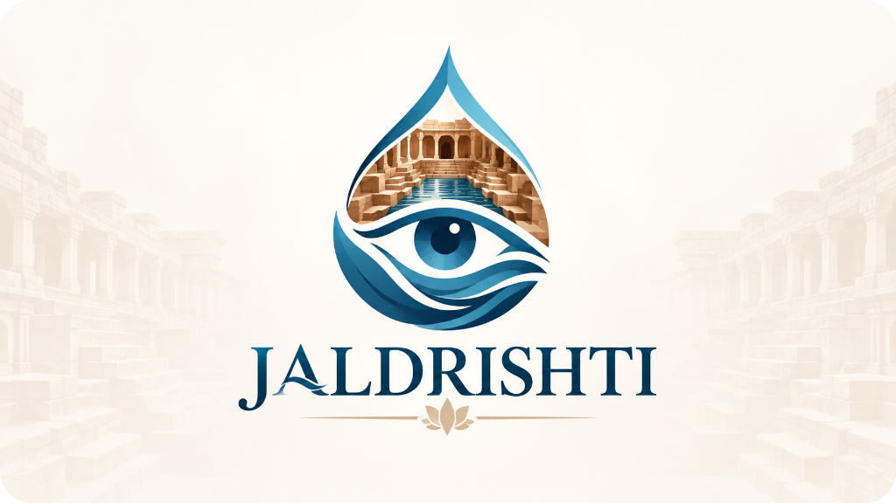
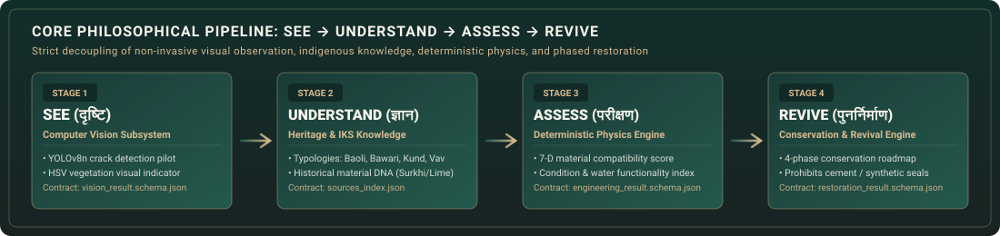
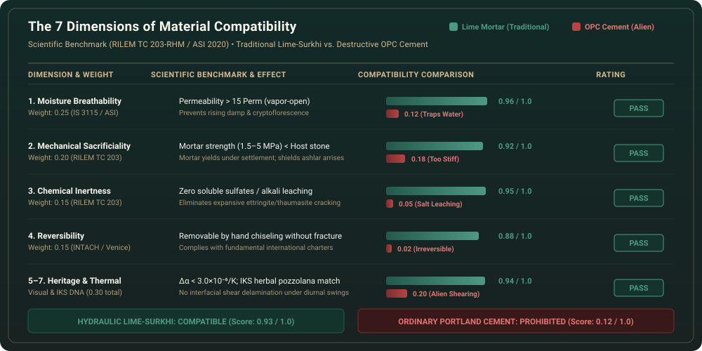
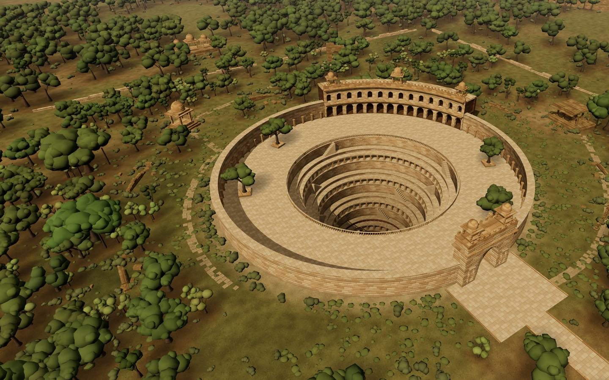
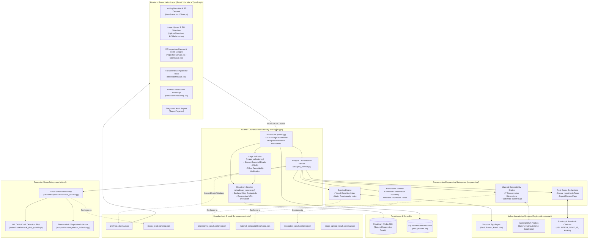

<div align="center">



# Jaldrishti
### AI-Assisted Conservation of Traditional Indian Water Heritage

[](https://www.python.org/)
[](https://fastapi.tiangolo.com/)
[](frontend/)
[](frontend/src/scene/)
[](https://jaldrishti-sigma.vercel.app)
[](tests/)
[](LICENSE)

<br/>

**A sovereign, explainable digital engineering platform connecting non-invasive computer vision, deterministic conservation physics, and Indian Knowledge Systems (IKS) to assess, diagnose, and safeguard historic stepwells, baolis, kunds, and bawaris.**

<br/>

[](https://jaldrishti-sigma.vercel.app)

<br/>

[Overview](#-overview--the-conservation-challenge) •
[The Solution](#-the-jaldrishti-solution) •
[Philosophy Showcase](#-core-philosophy-showcase) •
[Visual Demonstrations](#-visual-inspection--demonstration) •
[System Architecture](#-system-architecture) •
[Technology Stack](#-technology-stack) •
[Repository Structure](#-repository-structure) •
[Quickstart & Setup](#-installation--local-setup) •
[API Reference](#-api-reference) •
[Subsystem Deep Dives](#-subsystem-engineering--deep-dives) •
[Testing & QA](#-testing--quality-assurance) •
[Limitations & Disclaimer](#-limitations--responsible-use)

</div>

---

## 🏛️ Overview & The Conservation Challenge

Across the Indian subcontinent, thousands of historic stepwells (*baolis*, *vavs*), stepped catchment tanks (*kunds*, *bawaris*), and percolation reservoirs encapsulate over a millennium of ingenious hydraulic engineering and microclimatic design. Built between the 7th and 19th centuries across Rajasthan, Gujarat, Delhi, Bihar, and Madhya Pradesh, these monuments collected monsoon runoff, recharged unconfined alluvial and hard-rock aquifers, dampened semi-arid diurnal temperatures, and provided perennial drought security.

Today, these irreplaceable heritage assets face **three compounding crises**:

```
┌────────────────────────────────────────────────────────────────────────────────────────┐
│                              THE HERITAGE WATER CRISIS                                 │
├──────────────────────────┬──────────────────────────┬──────────────────────────────────┤
│   Physical Degradation   │  The Cement Catastrophe  │  Knowledge Fragmentation & Void  │
├──────────────────────────┼──────────────────────────┼──────────────────────────────────┤
│ • Invasive Ficus roots   │ • Non-breathable Ordinary│ • Traditional chunam/surkhi      │
│   (Peepal/Banyan) wedging│   Portland Cement (OPC)  │   craftsmanship fading with      │
│   open ashlar joints.    │   pointings trap rising  │   elderly artisan guilds.        │
│ • Unconfined aquifer     │   groundwater.           │ • Archaic treatises (Shilpa      │
│   bed siltation choking  │ • Rigid cement forces    │   Shastras) disconnected from    │
│   permeable recharge.    │   stresses into softer   │   modern diagnostic tools.       │
│ • Evaporative salt       │   historic sandstone,    │ • No standardized non-invasive   │
│   crystallization        │   causing accelerated    │   framework for rapid baseline   │
│   (sub-surface crypto-   │   delamination and       │   field survey audits across     │
│   florescence spalling). │   stone arrises loss.    │   thousands of regional sites.   │
└──────────────────────────┴──────────────────────────┴──────────────────────────────────┘
```

1. **Rampant Structural & Biological Breakdown:** Deep woody vegetation roots exert continuous outward mechanical pressure on subterranean retaining walls. Silt blankets up to several meters thick seal permeable bottom strata, cutting off aquifer recharge and stagnating water.
2. **The Ordinary Portland Cement (OPC) Catastrophe:** Well-intentioned but devastating modern repairs routinely point historic lime masonry with rigid, impermeable Portland cement or epoxy coatings. This creates a vapor barrier that traps rising damp inside the stone. Water is forced to evaporate through the stone face rather than the joints, triggering sub-surface salt crystallization (cryptoflorescence) that permanently disintegrates historic sandstone and quartzite arrises.
3. **Disappearing Craft Wisdom & Opaque Tools:** Authentic formulations—such as slaked fat lime putty aged in pits, reactive calcined clay (*surkhi*), and traditional fermented organic admixtures (*jaggery*, *urad dal*, *bael* pulp)—remain scattered across archaic manuscripts and artisan oral histories. Meanwhile, modern generic AI systems act as unaccountable "black boxes" that hallucinate recommendations without scientific or statutory grounding.

---

## 💡 The JalDrishti Solution

**Jaldrishti** replaces guesswork and harmful repairs with an **explainable, non-invasive digital diagnostic system**. It provides conservation architects, archaeologists, civic administrators, and heritage researchers with transparent, audit-ready decision support.

```
┌──────────────────────────────────────────────────────────────────────────────────────────────────┐
│                                    VERIFIED CORE CAPABILITIES                                    │
├───────────────────────────────┬──────────────────────────────────┬───────────────────────────────┤
│    Non-Invasive Perception    │    Deterministic Conservation    │   Authentic Decision Support  │
├───────────────────────────────┼──────────────────────────────────┼───────────────────────────────┤
│ • YOLOv8n crack pilot trained │ • 7-Dimension Material Matrix    │ • 4-Phase conservation        │
│   on heritage stone masonry.  │   (Moisture, Mechanical, Chem,   │   roadmap generator.          │
│ • Deterministic HSV green     │   Reversibility, Heritage, etc.).│ • Explicit prohibitions on    │
│   filtering for vegetation.   │ • Mathematical Condition &       │   Portland cement & epoxies.  │
│ • Image-space pixel metrics   │   Water Functionality scoring.   │ • Citations to ASI, INTACH,   │
│   (zero dimension invention). │ • Root-cause deduction trees.    │   CPWD, IS & RILEM standards. │
└───────────────────────────────┴──────────────────────────────────┴───────────────────────────────┘
```

> [!IMPORTANT]
> **Strict Non-Hallucination Safety Boundary:**  
> JalDrishti strictly separates visual observation from engineering computation. Computer vision identifies and measures visible defects in image space; **deterministic mathematical formulas and rule deduction engines calculate all condition scores, compatibility ratings, and restoration priorities**. Under no circumstances does an AI model invent millimeter widths, estimate unseen structural capacity, or approve safety certifications.

---

## 🔄 Core Philosophy Showcase

The central visual and architectural foundation of Jaldrishti is the **SEE $\rightarrow$ UNDERSTAND $\rightarrow$ ASSESS $\rightarrow$ REVIVE** cycle. Each stage answers a precise, scoped question without trespassing on the authority of other disciplines:

<div align="center">
  
</div>

<br/>

| Stage | Philosophical Tenet | Primary Question Answered | Implementation & Subsystem | Concrete Output Produced |
| :---: | :--- | :--- | :--- | :--- |
| **SEE**<br/>*(दृष्टि)* | **Non-Invasive Observation** | *"What surface defects are visibly present?"* | **Computer Vision**<br>• Fine-tuned YOLOv8n pilot<br>• Deterministic HSV vegetation filter | • Crack bounding boxes & confidence<br>• Biological growth coverage ratio<br>• Connected component counts & lengths |
| **UNDERSTAND**<br/>*(ज्ञान)* | **Contextual Heritage Wisdom** | *"What architectural and material DNA governs this site?"* | **Indian Knowledge Systems**<br>• Typology registry (Baoli, Kund, Vav)<br>• Historical material profiles | • Aquifer depth & catchment profiles<br>• Traditional stone & mortar DNA<br>• Statutory citations (ASI, INTACH, IS) |
| **ASSESS**<br/>*(परीक्षण)* | **Deterministic Science** | *"What can we quantitatively infer using defined rules?"* | **Engineering Rule Engine**<br>• Visual Condition & Water Index<br>• 7-D Material Compatibility Matrix | • Normalized condition scores (0–100)<br>• 7-D compatibility ratings & warnings<br>• Root-cause failure deduction chains |
| **REVIVE**<br/>*(पुनर्निर्माण)* | **Material-Compatible Revival** | *"What phased actions should be considered?"* | **Restoration Planner**<br>• Phased intervention planner<br>• Material prohibition engine | • 4-Phase conservation roadmap<br>• Urgent stabilization directives<br>• Prohibited modern material alerts |

### End-to-End Component Communication Flow:

```mermaid
sequenceDiagram
    autonumber
    actor Surveyor as Field Surveyor / Architect
    participant UI as React 18 / Three.js PWA
    participant API as FastAPI Gateway
    participant Cloud as Cloudinary CDN
    participant DB as SQLite (jaldrishti.db)
    participant Vision as Vision Subsystem (YOLOv8 + OpenCV)
    participant Eng as Engineering & IKS Engines

    Surveyor->>UI: Uploads survey photo & selects structure typology
    UI->>API: POST /images/upload (Streaming multipart payload)
    Note over API: Bounded stream read (<=25MB), Pillow decodability validation
    API->>Cloud: Upload validated image bytes (backend-only credentials)
    Cloud-->>API: Returns asset_id, public_id, responsive URLs
    API->>DB: Persist ImageMetadata (image_id, inspection_id, dimensions)
    API-->>UI: HTTP 201 Created (ImageUploadResponse)

    Surveyor->>UI: Configures optional ROI bounding box & triggers analysis
    UI->>API: POST /analyze (Payload with image reference / bytes)
    
    rect rgb(18, 60, 58)
        Note over API,Vision: SEE: Vision Defect Extraction
        API->>Vision: analyze_image(bytes, ROI, typology)
        Vision-->>API: VisionResult (crack boxes, veg coverage, component counts)
    end

    rect rgb(36, 89, 77)
        Note over API,Eng: UNDERSTAND & ASSESS: IKS + Deterministic Rules
        API->>Eng: assess_full_structure(typology, vision_metrics, inspection_notes)
        Eng->>Eng: Calculate Visual Condition & Water Functionality indices
        Eng->>Eng: Execute Root-Cause deduction rules & assign expert flags
        Eng->>Eng: Evaluate 7-Dimension Material Compatibility Matrix
        Eng->>Eng: Formulate 4-Phase Conservation Roadmap
        Eng-->>API: Structured Engineering Assessment Dict
    end

    API->>API: Assemble & validate unified contract (contracts/analysis.schema.json)
    API-->>UI: HTTP 200 OK (Unified Analysis Contract JSON)
    UI->>Surveyor: Renders 2D overlays, score gauges, 7-D radar & downloadable audit report
```



---

## 📸 Visual Inspection & Demonstration

### 1. Computer Vision Defect Detection (Darbhanga Fort Field Imagery)

Below are genuine evaluation outputs generated by the vision pipeline (`vision/demo_assets/`) evaluating heritage stone masonry:

| Inspection Subject | Unprocessed Survey Photograph | Vision Pipeline Inference Overlay | Detection Analysis |
| :---: | :---: | :---: | :--- |
| **Structural Masonry Crack**<br>*(Pilot Test Sample 1)* |  |  | **Confidence:** `0.84`<br>**BBox:** `[3, 298, 646, 768]`<br>**Analysis:** Continuous vertical shear crack across ashlar jointing. |
| **Vegetation Intrusion**<br>*(Pilot Test Sample 1)* |  |  | **Indicator:** `Detected`<br>**Coverage Ratio:** `15.18%`<br>**Analysis:** Severe biological moss and invasive root penetration across bedding planes. |
| **Sound Historic Masonry**<br>*(Baseline Control 1)* |  |  | **Crack Detected:** `False`<br>**Veg Coverage:** `0.0%`<br>**Analysis:** Intact historic stone fabric with sound joints; baseline established. |

### 2. The 7-Dimension Material Compatibility Matrix

Jaldrishti's deterministic compatibility engine mathematically proves why modern Portland cement is destructive to historic masonry while traditional hydraulic lime-surkhi is protective:

<div align="center">
  
</div>

<br/>

### 3. Digital Twin 3D Descent View

The frontend features a procedural Three.js subterranean descent through an illustrative Indian stepwell, modeling daylight penetration, ashlar stonework courses, and the subterranean water table:

<div align="center">
  
  <p><sub><em>Opening frame of the procedural 3D stepwell descent (Three.js WebGL viewport). Disclosed in-app as an illustrative architectural model, not an uncalibrated survey of a single site.</em></sub></p>
</div>

---

## 🏗️ System Architecture

Jaldrishti is built on a **sovereign, local-first, micro-modular architecture** where every component communicates across standardized JSON Schema boundaries:



---

## 💻 Technology Stack

```
┌────────────────────────────────────────────────────────────────────────────────────────┐
│                                 TECHNOLOGY STACK MATRIX                                │
├───────────────────────┬────────────────────────────┬───────────────────────────────────┤
│ Layer / Role          │ Technology & Version       │ Specific Responsibility           │
├───────────────────────┼────────────────────────────┼───────────────────────────────────┤
│ Frontend & PWA        │ React 18.3, TypeScript 5.5 │ Modular, type-safe client UI.     │
│                       │ Vite 5.4, Tailwind CSS 3.4 │ Fast HMR, custom design tokens.   │
│                       │ Three.js 0.185 (Pinned)    │ 3D stepwell descent visualization.│
├───────────────────────┼────────────────────────────┼───────────────────────────────────┤
│ Backend Orchestration │ FastAPI 0.100+, Python 3.10│ Async REST routing & pipeline hub.│
│                       │ Pydantic v2.0+             │ Strict schema parsing/validation. │
│                       │ Uvicorn 0.23+              │ High-performance ASGI runtime.    │
│                       │ jsonschema 4.18+           │ Inter-module contract governance. │
├───────────────────────┼────────────────────────────┼───────────────────────────────────┤
│ Vision & Perception   │ PyTorch, Ultralytics YOLOv8│ Fine-tuned crack pilot inference. │
│                       │ OpenCV 4.8, Pillow 10.0    │ HSV vegetation & stream parsing.  │
├───────────────────────┼────────────────────────────┼───────────────────────────────────┤
│ Conservation Eng.     │ Python 3.10+               │ Deterministic 7-D compatibility,  │
│ & Knowledge Base      │ JSON Schema (Draft-07)     │ scoring & IKS knowledge lookup.   │
├───────────────────────┼────────────────────────────┼───────────────────────────────────┤
│ Storage & Persistence │ Cloudinary Python SDK 1.36 │ Backend-controlled CDN storage.   │
│                       │ SQLite3 (Standard Library) │ Durable metadata persistence.     │
├───────────────────────┼────────────────────────────┼───────────────────────────────────┤
│ Testing & Validation  │ pytest 7.4+, httpx 0.24+   │ 183 automated tests (100% pass).  │
└───────────────────────┴────────────────────────────┴───────────────────────────────────┘
```

---

## 📁 Repository Structure

```
jaldrishti/
├── api/                                # Serverless gateway entrypoint
│   └── index.py                        # Exports FastAPI ASGI app
├── backend/                            # FastAPI backend orchestration subsystem
│   ├── app/
│   │   ├── api/router.py               # API route definitions and endpoint handlers
│   │   ├── core/config.py              # Strongly-typed environment settings (Pydantic)
│   │   ├── db/image_repository.py      # SQLite durable metadata persistence layer
│   │   ├── main.py                     # Application factory and CORS middleware
│   │   ├── schemas/                    # Pydantic models matching JSON contract schemas
│   │   ├── services/                   # Orchestrator, Cloudinary, Vision & Eng services
│   │   └── utils/                      # Bounded-stream reader & contract validators
│   └── README.md                       # Backend subsystem documentation
├── contracts/                          # Immutable JSON Schema interchange contracts
│   ├── analysis.schema.json            # Unified pipeline analysis contract (Draft-07)
│   ├── engineering_result.schema.json  # Engineering score indices and limitations
│   ├── image_upload_result.schema.json # Image ingestion and metadata schema
│   ├── material_compatibility.schema.json # 7-D material evaluation matrix schema
│   ├── restoration_result.schema.json  # Phased conservation roadmap schema
│   └── vision_result.schema.json       # Vision detection bounding box and mask schema
├── data/                               # Local data directory and SQLite storage
│   ├── jaldrishti.db                   # Durable SQLite database (image metadata)
│   └── README.md                       # Dataset policies and Git-exclusion notes
├── docs/                               # Architectural and technical documentation
│   ├── assets/                         # Genuine SVG graphics and visual banners
│   │   ├── jaldrishti_logo.png         # Official high-resolution project logo
│   │   ├── jaldrishti_hero_banner.svg  # Master architectural stepwell banner
│   │   ├── material_compatibility_matrix.svg # 7-D compatibility comparison matrix
│   │   └── workflow_pipeline.svg       # See-Understand-Assess-Revive pipeline graphic
│   ├── architecture.md                 # System architecture and responsibility boundaries
│   ├── engineering_pipeline.md         # Conservation engineering calculations
│   └── vision_pipeline.md              # Vision detection specifications
├── engineering/                        # Conservation engineering and IKS rules engine
│   ├── assessment.py                   # High-level assessment coordinator
│   ├── knowledge_lookup.py             # IKS ontology and source citation engine
│   ├── material_compatibility/         # 7-D compatibility evaluation engine
│   ├── restoration/                    # 4-phase conservation roadmap generator
│   ├── root_cause/                     # Evidence-backed causal failure deduction trees
│   ├── scoring/                        # Deterministic condition & water scoring
│   ├── service.py                      # Engineering subsystem facade & safety caps
│   └── README.md                       # Conservation engineering documentation
├── frontend/                           # React 18 / TypeScript / Three.js PWA
│   ├── public/                         # Static assets, PWA manifest, and hero poster
│   ├── src/
│   │   ├── components/                 # Canvas, ScoreCard, Roadmap & 3D Scene container
│   │   ├── pages/                      # HomePage, UploadPage, AnalysisPage, ReportPage
│   │   ├── scene/                      # Three.js descent modules, shaders & lighting
│   │   └── services/api.ts             # Typed API client with offline mock fallback
│   ├── package.json                    # Frontend dependencies and build scripts
│   └── vite.config.ts                  # Vite build and proxy configuration
├── knowledge/                          # Curated Indian Knowledge Systems knowledgebase
│   ├── materials/                      # Material profiles (Surkhi, Hydraulic Lime, OPC)
│   ├── sources/sources_index.json      # Statutory citations (ASI, INTACH, BIS, RILEM)
│   ├── structures/                     # Architectural typologies (Baoli, Bawari, Kund, Vav)
│   └── README.md                       # Knowledgebase contribution protocols
├── scripts/                            # Operational, training, and evaluation scripts
│   └── vision/
│       ├── evaluate_pilot.py           # Evaluates YOLOv8n crack pilot on unseen images
│       ├── train_crack_pilot.py        # Fine-tunes YOLOv8n on heritage crack annotations
│       └── vegetation_indicator.py     # Deterministic HSV vegetation indicator
├── tests/                              # Comprehensive automated test suite (186 tests)
├── pyproject.toml                      # Python package build configuration and dependencies
├── requirements.txt                    # Python dependency manifest
├── Dockerfile                          # Multi-stage production container
├── render.yaml                         # Service deployment blueprint
├── vercel.json                         # Client and routing configuration
└── LICENSE                             # MIT Open-Source License
```

---

## 🚀 Installation & Local Setup

### Prerequisites
- **Python:** `3.10+` (`3.11` recommended)
- **Node.js:** `18.0.0+` (`20+` recommended)
- **Package Managers:** `pip` and `npm` (`9+`)

### 1. Clone & Environment Setup
```bash
git clone https://github.com/NotKrish019/JalDrishti.git
cd JalDrishti

# Configure environment variables
cp .env.example .env
```

### 2. Backend Virtual Environment
```bash
# Create and activate virtualenv
python3 -m venv .venv
source .venv/bin/activate  # On Windows: .venv\Scripts\activate

# Install dependencies in editable mode
pip install --upgrade pip
pip install -r requirements.txt
pip install -e ".[dev]"
```

### 3. Frontend Dependencies
```bash
cd frontend
npm install
cd ..
```

### 4. Verify Installation
```bash
pytest -v
```
*Expected output: All 183 automated tests pass in ~0.70 seconds.*

### 5. Launch Development Services

#### Terminal 1 — Backend API:
```bash
source .venv/bin/activate
uvicorn backend.app.main:app --host 127.0.0.1 --port 8000 --reload
```
- **API Base:** [http://127.0.0.1:8000](http://127.0.0.1:8000)
- **Interactive Swagger Docs:** [http://127.0.0.1:8000/docs](http://127.0.0.1:8000/docs)
- **ReDoc Documentation:** [http://127.0.0.1:8000/redoc](http://127.0.0.1:8000/redoc)

#### Terminal 2 — Frontend PWA:
```bash
cd frontend
npm run dev
```
- **Frontend Application:** [http://localhost:5173](http://localhost:5173)
<details>
<summary><strong>📦 Contributor Note: Dataset & Model Weight Policies</strong></summary>

In accordance with open-source repository hygiene:
- Large field datasets (e.g. raw Darbhanga Fort imagery) and intermediate checkpoints are excluded from Git via `.gitignore`.
- Developers maintain raw imagery locally in `data/raw/`.
- Lightweight verification models (`vision/models/crack_pilot_yolov8n.pt`) and evaluation outputs (`vision/demo_assets/`) are tracked directly in Git for out-of-the-box local testing.
</details>

---

## ⚙️ Configuration Reference

All backend settings are loaded through environment variables into Pydantic models (`backend/app/core/config.py`).

| Variable Name | Default Value | Required | Purpose |
| :--- | :--- | :---: | :--- |
| `BACKEND_HOST` | `127.0.0.1` | No | Uvicorn host binding interface. |
| `BACKEND_PORT` | `8000` | No | Uvicorn listening port. |
| `ENVIRONMENT` | `development` | No | Runtime mode (`development`, `production`). |
| `LOG_LEVEL` | `info` | No | Logging verbosity (`debug`, `info`, `warning`, `error`). |
| `CORS_ORIGINS` | `http://localhost:5173,...` | No | Allowed browser origins (wildcards prohibited). |
| `CLOUDINARY_CLOUD_NAME` | *None* | Optional* | Cloudinary cloud identifier. |
| `CLOUDINARY_API_KEY` | *None* | Optional* | Cloudinary API key. |
| `CLOUDINARY_API_SECRET` | *None* | Optional* | Cloudinary private secret (server-side only). |
| `CLOUDINARY_FOLDER` | `jaldrishti/inspections` | No | Cloud storage folder namespace. |
| `CLOUDINARY_SECURE_DELIVERY` | `true` | No | Enforces HTTPS for generated asset URLs. |
| `MAX_UPLOAD_SIZE_BYTES` | `26214400` *(25 MB)* | No | Max multipart upload byte limit. |
| `ALLOWED_IMAGE_FORMATS` | `jpeg,jpg,png,webp` | No | Whitelist of allowed image extensions. |
| `SQLITE_DB_PATH` | `data/jaldrishti.db` | No | Local SQLite database file path. |
| `VITE_API_BASE_URL` | `http://localhost:8000` | No | Target API URL used by the frontend client. |

*\*Note: If Cloudinary keys are omitted, the `/images/upload` endpoint returns HTTP 503 explaining that cloud media storage is unconfigured. The `/analyze` pipeline continues running fully offline via direct image bytes or pre-loaded test fixtures.*

---

## 📡 API Reference

Interactive OpenAPI documentation and live testing are accessible at [`http://127.0.0.1:8000/docs`](http://127.0.0.1:8000/docs).

### Summary of Verified Endpoints:

| Method & Route | Subsystem | Request Body | Response Contract | Purpose |
| :--- | :--- | :--- | :--- | :--- |
| `GET /health` | System | None | `HealthResponse` | Readiness and version check. |
| `POST /analyze` | Pipeline | JSON or Multipart | `AnalysisResult` | **Unified end-to-end conservation analysis.** |
| `POST /vision/analyze` | Vision | JSON or Multipart | `VisionResult` | Extracts and normalizes defect segments. |
| `POST /engineering` | Engineering | JSON | `EngineeringResult` | Computes condition and water functionality scores. |
| `POST /material-compatibility` | Materials | JSON | `MaterialCompatibilityResult`| Evaluates 7-D substrate compatibility matrix. |
| `POST /restore` | Restoration | JSON | `RestorationResult` | Formulates 4-phase conservation roadmap. |
| `POST /images/upload` | Images | Multipart File | `ImageUploadResponse` | Validates, stores to Cloudinary, and persists metadata. |
| `GET /images/{id}` | Images | None | `ImageUploadResponse` | Retrieves metadata and responsive delivery URLs. |
| `DELETE /images/{id}` | Images | None | `ImageDeleteResponse` | Deletes image with partial-failure safety. |
| `GET /inspections/{id}/images` | Images | None | `InspectionImagesListResponse`| Lists all imagery linked to an inspection session. |
| `GET /knowledge/structures` | Knowledge | None | `List[StructureSummary]` | Catalogs all water structure typologies. |
| `GET /knowledge/sources` | Knowledge | None | `List[SourceRecord]` | Catalogs peer-reviewed & statutory citations. |

<details>
<summary><strong>📄 View Sample Request &amp; Response for <code>POST /analyze</code></strong></summary>

**Sample Request (`POST /analyze`):**
```json
{
  "structure_type": "baoli",
  "name": "Agrasen ki Baoli",
  "region": "Delhi, Northern India",
  "source_images": ["agrasen_survey_01.jpg"],
  "inspection_data": {
    "siltation_level": "moderate",
    "inlet_condition": "partially_choked",
    "recent_repair_type": "portland_cement"
  },
  "inferred_material": "hydraulic_lime_mortar",
  "material_confidence": 0.85,
  "candidate_materials": ["hydraulic_lime_mortar", "surkhi_lime_mortar", "portland_cement_opc"]
}
```

**Representative Response (`contracts/analysis.schema.json`):**
```json
{
  "project_version": "0.1.0",
  "structure": {
    "type": "baoli",
    "name": "Agrasen ki Baoli",
    "region": "Delhi, Northern India",
    "source_images": ["agrasen_survey_01.jpg"]
  },
  "vision": {
    "structure_type": "baoli",
    "image_dimensions": { "width_pixels": 1920, "height_pixels": 1080 },
    "detections": [
      {
        "class_name": "crack",
        "confidence": 0.84,
        "bounding_box": [576.0, 378.0, 1248.0, 648.0],
        "pixel_area": 453600.0,
        "coverage_ratio": 0.2188,
        "component_count": 1,
        "relative_severity": "severe"
      }
    ],
    "processing_metadata": { "inference_latency_ms": 32.4, "model_version": "jaldrishti-vision-v0.2.0" }
  },
  "visual_condition": {
    "score": 62.5,
    "confidence": 0.85,
    "rating": "degraded",
    "limitations": "Score derived strictly from visible 2D surface defects."
  },
  "water_functionality": {
    "score": 45.0,
    "confidence": 0.80,
    "rating": "impaired",
    "limitations": "Hydrological score inferred from visual siltation indicators."
  },
  "material": {
    "original_material": "hydraulic_lime_mortar",
    "overall_compatibility_verdict": "compatible",
    "evaluations": [
      {
        "candidate_material": "surkhi_lime_mortar",
        "compatibility_score": 0.93,
        "verdict": "compatible",
        "dimension_scores": {
          "moisture": 0.96, "mechanical": 0.92, "chemical": 0.95,
          "reversibility": 0.88, "heritage": 0.95, "thermal": 0.94, "visual": 0.90
        }
      },
      {
        "candidate_material": "portland_cement_opc",
        "compatibility_score": 0.12,
        "verdict": "prohibited",
        "warning": "CRITICAL RISK: Non-breathable cement induces salt cryptoflorescence."
      }
    ]
  },
  "root_cause": {
    "primary_cause": "Incompatible Portland Cement Repair Barrier",
    "count": 1,
    "findings": [
      {
        "defect_type": "chemical_moisture_incompatibility",
        "probable_cause": "Incompatible Portland Cement Repair Barrier",
        "recommended_investigation": "Perform joint raking trials and phenolphthalein carbonation testing.",
        "expert_review_required": true,
        "review_specialty": "Architectural Conservation Specialist"
      }
    ]
  },
  "restoration": {
    "structure_type": "baoli",
    "urgent_actions": [
      "Mechanically remove non-breathable Portland cement joint repointing using manual non-impact tools."
    ],
    "phases": [
      { "phase_number": 1, "title": "Immediate Physical Stabilization", "actions": ["Erect temporary timber shoring beneath compromised arches."] },
      { "phase_number": 2, "title": "Hydrological Remediation", "actions": ["Manually desilt stepwell bottom basin without heavy machinery."] },
      { "phase_number": 3, "title": "Masonry Consolidation & IKS Repointing", "actions": ["Repoint raked joints using breathable hydraulic lime-surkhi pozzolana mortar (1:2:1 ratio)."] },
      { "phase_number": 4, "title": "Long-Term Monitoring & Stewardship", "actions": ["Install calibrated tell-tale crack displacement monitors."] }
    ]
  },
  "metadata": {
    "created_at": "2026-10-21T03:30:00Z",
    "pipeline_status": "completed",
    "orchestrated_by": "JalDrishti Multi-Disciplinary Orchestrator"
  }
}
```
</details>

---

## 🔬 Subsystem Engineering & Deep Dives

### 1. Bounded Image Ingestion & Storage Pipeline
- **Bounded Stream Protection:** Uploads enforce a strict 25 MB stream limit (`MAX_UPLOAD_SIZE_BYTES`) directly during streaming, terminating transfers before excess bytes touch system memory.
- **Pillow Decoding:** Verifies actual content decodability (rejecting spoofed file extensions).
- **Backend Credential Isolation:** Cloudinary API secrets remain server-side; client applications receive signed, transformed delivery URLs (`c_limit,w_800`, `c_fill,h_300`).
- **Atomic Two-Phase Persistence:** If database metadata writing fails after a successful Cloudinary upload, an automated compensating deletion call rolls back the cloud asset to prevent orphaned files.

### 2. Computer Vision Pipeline Boundary
- **Crack Pilot:** Ultralytics YOLOv8n fine-tuned on historic masonry cracks (`vision/models/crack_pilot_yolov8n.pt`).
- **OpenCV Vegetation Filter:** Deterministic HSV color-space thresholding (H: 28–90, S: 30–255, V: 30–255) with morphological opening/closing kernels and component area filtering ($>50\text{ px}$).
- **Zero Hallucination Guarantee:** All outputs remain strictly in image-space pixels and relative ratios (`coverage_ratio`, `pixel_area`, `component_count`). Physical millimeters are never fabricated.

### 3. Conservation Engineering & 7-D Material Science
The compatibility engine benchmarks intervention materials across **7 deterministic criteria**:
1. **Moisture Breathability (0.25):** Vapor permeability $>15$ Perm (IS 3115 / ASI 2020) to prevent cryptoflorescence.
2. **Mechanical Sacrificiality (0.20):** Compressive strength ($1.5–5.0\text{ MPa}$) lower than host stone (RILEM TC 203-RHM).
3. **Chemical Inertness (0.15):** Zero soluble sulfates to prevent expansive ettringite/thaumasite formation.
4. **Reversibility (0.15):** Mortar extractable using hand chisels without damage to stone arrises (INTACH Charter §5).
5. **Heritage & IKS (0.10):** Conformance to traditional slaked lime-surkhi pozzolana standards (CPWD Heritage Guidelines).
6. **Thermal Dilation (0.10):** Coefficient matching ($\Delta\alpha < 3.0 \times 10^{-6}/\text{K}$) for $>25^\circ\text{C}$ semi-arid diurnal swings.
7. **Visual & Patina (0.05):** Harmonious aggregate texture and warm sandstone/quartzite coloration.

> [!TIP]
> **Substrate Safety Cap:** If substrate stone identification confidence is $<0.60$, the engine automatically caps recommendations at `acceptable_conditional` and issues an advisory that laboratory petrography is mandatory.

### 4. Authoritative Statutory & Academic Sources
All logic traces to 11 peer-reviewed and statutory standards cataloged in [`knowledge/sources/sources_index.json`](knowledge/sources/sources_index.json):
- **ASI & INTACH (2020):** *Architectural Conservation: Principles and Practice in India*.
- **INTACH Charter (2004):** *Charter for the Conservation of Unprotected Architectural Heritage and Sites in India*.
- **CPWD Heritage Directorate (2013):** *Handbook of Conservation of Heritage Buildings*, Government of India.
- **Central Ground Water Board (2021):** *Traditional Water Harvesting Structures and Sustainable Groundwater Management in India*.
- **Bureau of Indian Standards (BIS):** *IS 712 (Building Limes)* and *IS 3115 (Lime-Pozzolana Mixtures)*.
- **RILEM Technical Committee 203-RHM (2012):** *Historic Mortars: Characterisation, Assessment and Repair*, Springer.
- **Morna Livingston (2002):** *Steps to Water: The Ancient Stepwells of India*, Princeton Architectural Press.
- **Jutta Jain-Neubauer (1981):** *The Stepwells of Gujarat in Art-Historical Perspective*, Abhinav Publications.
- **Anil Agarwal & Sunita Narain (1997):** *Dying Wisdom: Rise, Fall and Potential of India's Traditional Water Harvesting Systems*, CSE.

---

## 🧪 Testing & Quality Assurance

Jaldrishti enforces rigorous automated testing across all subsystems. The full test suite of **183 automated tests passes in ~0.70 seconds**:

```
============================== test session starts ==============================
platform darwin -- Python 3.14.3, pytest-7.4.4, pluggy-1.5.0
rootdir: /Users/pro/Desktop/projects/jaldrishti
configfile: pyproject.toml
testpaths: tests
collected 183 items

tests/backend/test_analysis_schemas.py .........                         [  4%]
tests/backend/test_api_endpoints.py .................                   [ 14%]
tests/backend/test_engineering_schemas.py .......                        [ 18%]
tests/backend/test_health_and_routes.py ......                           [ 21%]
tests/backend/test_image_upload.py ..............                        [ 29%]
tests/backend/test_material_schemas.py .......                           [ 33%]
tests/backend/test_restoration_schemas.py .......                        [ 36%]
tests/backend/test_vision_schemas.py ..........                          [ 42%]
tests/contracts/test_schemas.py ........                                 [ 46%]
tests/engineering/test_iks_knowledge.py ...................              [ 57%]
tests/engineering/test_material_compatibility.py ...............         [ 65%]
tests/engineering/test_phase3_engines.py .............                   [ 72%]
tests/engineering/test_phase4_integration.py ...........                 [ 78%]
tests/frontend/test_frontend_components.py ......                        [ 81%]
tests/frontend/test_landing_experience.py ...............                [ 90%]
tests/integration/test_contract_compatibility.py .........               [ 95%]
tests/smoke/test_frontend_scaffold.py ..                                 [ 96%]
tests/smoke/test_health.py .                                             [ 96%]
tests/smoke/test_imports.py ...                                          [ 98%]
vision/tests/test_audit.py .                                             [100%]

======================== 183 passed, 1 warning in 0.70s ========================
```

### Targeted Test Commands:
```bash
# Run the entire test suite
pytest -v

# Run only conservation engineering and material compatibility tests
pytest tests/engineering/ -v

# Run backend API endpoints and image upload tests
pytest tests/backend/ -v

# Run JSON schema contract validation tests
pytest tests/contracts/ tests/integration/ -v

# Run frontend honesty and architecture tests
pytest tests/frontend/ -v
```

---

## 🔒 Security, Privacy & Reliability

- **Zero Client Credential Leakage:** Cloudinary API secrets and database paths are restricted to the server environment. The frontend client bundle contains zero private keys.
- **Bounded Streaming Upload Defense:** By enforcing a strict 25 MB stream limit before decoding, the upload gateway prevents memory-exhaustion Denial-of-Service attacks from multi-gigabyte files.
- **Zero Hallucination Engineering Guardrails:** LLMs or unverified generative models are strictly prohibited from calculating engineering condition scores or formulating chemical recipes. All scores are computed deterministically.
- **CORS Protection:** Cross-Origin Resource Sharing is locked to local development origins (`http://localhost:5173`, `http://127.0.0.1:5173`). Wildcard `*` origins are rejected in production.
- **Rollback Resilience:** Any database failure during file upload automatically triggers a compensating deletion against Cloudinary, preventing orphaned cloud assets.
- **Log Masking:** All internal logger handlers mask sensitive credentials and API keys in exception messages before emitting log output.

---

## ⚠️ Limitations & Responsible Use

> [!CAUTION]
> **MANDATORY CONSERVATION DISCLAIMER**
> 
> JalDrishti is an **assistive diagnostic decision-support system**. It is **not** a licensed structural engineering authority, archaeological certification body, or statutory planning agency.

1. **Non-Invasive Visual Limits:** 2D surface photographs cannot detect internal masonry core voids, foundation soil shear failures, deep groundwater table subsidence, or out-of-plane retaining wall bowing.
2. **Mandatory Laboratory Petrography:** Visual inference of historic stone and mortar is probabilistic. Before specifying final quarry sand gradings or lime slaking ratios, authorized conservators must execute petrographic thin-section analysis, X-ray diffraction (XRD), and acid dissolution tests on physical samples.
3. **Provisional Screening Heuristics:** The numerical weights in the 7-dimension material compatibility matrix represent synthesized conservation literature heuristics for preliminary screening. Field trial test panels (minimum 28-day cure) are mandatory prior to full-scale repointing.
4. **Site-Specific Statutory Clearances:** All physical interventions on heritage monuments require prior formal statutory clearances from the Archaeological Survey of India (ASI), State Archaeology Directorates, or relevant municipal heritage committees.

---

## 🤝 Contributing & Community

Contributions are warmly welcomed from conservation architects, software engineers, archaeologists, and heritage researchers! Whether it is adding structural typologies, refining computer vision models, improving documentation, or reporting issues, we appreciate your help in safeguarding India's water heritage.

1. **Fork** the repository and create your feature branch: `git checkout -b feature/amazing-feature`
2. **Commit** your changes: `git commit -m 'feat: add amazing feature'`
3. **Push** to the branch: `git push origin feature/amazing-feature`
4. **Open a Pull Request** with a detailed description of your changes.

---

## 👥 Core Maintainers & Contributors

### Team NeuralX:

| <br/>**Krish** | <br/>**Kirti Antil** | <br/>**Anika Jain** | <br/>**Swastik Parmar** |
| :---: | :---: | :---: | :---: |
| [](https://github.com/NotKrish019)<br/><sub>Computer Vision & AI Lead</sub> | [](https://github.com/KirtiAntil)<br/><sub>IKS & Conservation Engineering</sub> | [](https://github.com/AnikaJain)<br/><sub>Frontend & Digital Twin Lead</sub> | [](https://github.com/swastikparmar987)<br/><sub>Backend & System Orchestration</sub> |

<br/>

### Project Contributors:

<a href="https://github.com/NotKrish019/JalDrishti/graphs/contributors">
  
</a>

---

## 📜 License

This project is licensed under the **[MIT License](LICENSE)**.

---

## 📚 Citation

```bibtex
@software{jaldrishti2026,
  author = {Krish and Antil, Kirti and Jain, Anika and Parmar, Swastik},
  title = {JalDrishti: AI-Assisted Conservation of Traditional Indian Water Heritage},
  year = {2026},
  publisher = {GitHub},
  url = {https://github.com/NotKrish019/JalDrishti}
}
```

---

<div align="center">
  <sub>Preserving India's timeless hydraulic wisdom through sovereign, transparent digital engineering.</sub><br>
  <strong>JalDrishti — Connecting Stone, Water, and Science.</strong>
</div>
