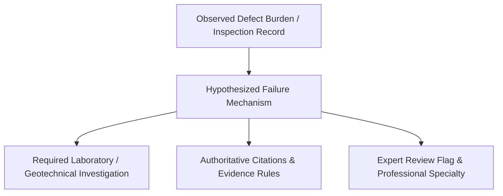

# JalDrishti Conservation Engineering Subsystem

**Lead:** Kirti Antil (IKS, Material Compatibility & Conservation Engineering Lead)  
**Team:** NeuralX  
**Subsystem Ownership:** `knowledge/`, `engineering/`, `tests/engineering/`  
**Status:** **PHASE 3 & PHASE 4 ENHANCED (Explainable Material Compatibility, Transparent Decision Support & Full Contract Conformance)**

---

## 1. Subsystem Architecture & Philosophy

The Conservation Engineering Subsystem serves as the scientific and deterministic reasoning core of JalDrishti. It translates visual defect measurements and inspection data into traceable conservation assessments:

$$\mathbf{\text{SEE (Computer Vision)}} \longrightarrow \mathbf{\text{UNDERSTAND (IKS Knowledge)}} \longrightarrow \mathbf{\text{ASSESS (Compatibility \& Diagnostic Rules)}} \longrightarrow \mathbf{\text{REVIVE (Phased Restoration)}}$$

### Core Conservation Principles:
1. **Decision Support, Not Autonomous Authority:**  
   JalDrishti is a non-invasive decision-support platform designed to assist qualified conservation professionals. It **never** certifies structural safety, guarantees subsurface integrity, or prescribes definitive chemical repair mixtures based solely on photographic evidence.
2. **Observed Facts vs. Inferred Causes:**  
   Direct visual observations (e.g. spalling burden, joint vegetation, crack coverage) are strictly decoupled from causal hypotheses (e.g. salt cryptoflorescence, foundation settlement).
3. **Sacrificiality & Minimum Intervention:**  
   Repair mortars must possess lower compressive strength, lower stiffness (elastic modulus), and higher vapor permeability than the historic host masonry (RILEM TC 203-RHM). Incompatible modern materials (e.g., Portland cement, acrylics, epoxies) are explicitly flagged as prohibited.

---

## 2. Material Compatibility Engine

The Material Compatibility Engine evaluates candidate repair materials against identified historic substrates across **7 deterministic, multi-dimensional conservation engineering criteria**:

### The 7 Dimensions of Compatibility:

| Dimension | Weight | Scientific Rule & Citation | Target Behavior |
| :--- | :---: | :--- | :--- |
| **1. Moisture** | **0.25** | Breathability & vapor permeability (IS 3115 / ASI 2020) | Permeability must match or exceed host stone ($\ge 0.70\times$ substrate, ideally $\ge 0.90\times$). Prevents subsurface rising damp entrapment and cryptoflorescence. |
| **2. Mechanical** | **0.20** | Sacrificial stiffness & strength (RILEM TC 203-RHM) | Mortar compressive strength must be within $40\%-120\%$ of substrate; elastic modulus must be significantly lower to act as sacrificial joint. |
| **3. Chemical** | **0.15** | Absence of soluble salts & alkalis (RILEM TC 203-RHM) | Zero soluble sulfates, sodium, or potassium hydroxides. Eliminates risk of expansive ettringite/thaumasite mineral formation. |
| **4. Reversibility** | **0.15** | Retreatability without substrate loss (INTACH Charter §5 / Venice Charter) | Joint mortar must be extractable using manual hand tools without fracturing historic stone arrises (reversibility score $\ge 8.0/10$). |
| **5. Heritage** | **0.10** | Traditional craftsmanship & IKS alignment (ASI 2020 / CPWD 2013) | Conforms to traditional slaked hydraulic lime and calcined clay surkhi pozzolana practices; avoids modern industrial alien binders. |
| **6. Thermal** | **0.10** | Diurnal thermal expansion matching ($\Delta \alpha \le 3.0 \times 10^{-6}/\text{K}$) | Minimizes interfacial shear delamination under semi-arid diurnal temperature extremes ($>25^\circ\text{C}$ daily swings). |
| **7. Visual** | **0.05** | Patina, aggregate texture, and color harmony | Warm terracotta and buff tones harmonizing with weathered historic sandstone/quartzite. |

### Provisional Weight Status & Validation Requirements:
The weights above are **PROVISIONAL SCREENING HEURISTICS** synthesized from conservation consensus literature. They provide a risk-ranked screening indicator for preliminary decision support. Before certifying specifications for physical execution, the following laboratory validation is required:
1. Empirical shear-bond strength laboratory testing across regional sandstone varieties (e.g., Dholpur sandstone, Delhi quartzite).
2. Cyclic salt-crystallization chamber durability testing for hydraulic lime-surkhi blends under simulated monsoon wetting/drying cycles.
3. Field calibration against monitored long-term in-situ mortar test panels.

### Handling Missing and Conflicting Data:
- **Missing Data:** If property ranges (e.g., compressive strength, vapor permeability) are missing in input data, the engine records an explicit `MISSING DATA` warning, utilizes conservative screening defaults, and notes that in-situ testing is mandatory.
- **Conflicting Data:** If property ranges are inverted ($\min > \max$) or negative, the engine normalizes the bounds, clamps values to valid domains, and emits an explicit `CONFLICTING DATA` warning.
- **Low-Confidence Substrate Inference Safety Cap:**  
  When substrate material confidence is low ($< 0.60$) or based solely on visual inference, recommendations are automatically capped at `"acceptable_conditional"` with an explicit advisory notice:  
  *Photographic evidence is insufficient for definitive mortar formulation; laboratory petrography is mandatory before specifying final mix proportions.*

---

## 3. Conservation Decision Support & Diagnostic Rules

### Root Cause Deductions (`engineering/root_cause/deduction_rules.py`):
The diagnostic engine builds a transparent chain connecting observed defect metrics to causal hypotheses, required investigations, and expert review requirements:



1. **Invasive Woody Vegetation:**  
   - *Observation:* Vegetation burden $>5\%$ or stone dislodgement $>5\%$.  
   - *Mechanism:* Radial root expansion wedging open mortar joints and dislodging stones.  
   - *Investigation:* Endoscopic fiber-optic void probing; botanical root identification.  
   - *Expert Flag:* `expert_review_required: True` (*Structural Heritage Engineer*).
2. **Inflow Starvation & Encroachment:**  
   - *Observation:* Inlet choked/broken or catchment encroached.  
   - *Mechanism:* Catchment disconnection causing chronic hydraulic desiccation.  
   - *Investigation:* Drone micro-topographic runoff survey; inlet silt trap excavation.  
   - *Expert Flag:* `expert_review_required: False` (*Conservation Surveyor*).
3. **Bed Siltation & Aquifer Choking:**  
   - *Observation:* Moderate to severe siltation.  
   - *Mechanism:* Compacted sediment blanket sealing unconfined aquifer interface.  
   - *Investigation:* Sediment core auger sampling; infiltration testing; contaminant assay.  
   - *Expert Flag:* `expert_review_required: True` (*Hydrogeologist*).
4. **Moisture Entrapment & Stone Spalling:**  
   - *Observation:* Spalling burden $>5\%$ or stagnant water with blocked drainage.  
   - *Mechanism:* Rising damp and evaporative cryptoflorescence crystallization pressure.  
   - *Investigation:* Soluble salt ion chromatography (sulfates/nitrates); moisture grid mapping.  
   - *Expert Flag:* `expert_review_required: True` (*Senior Stone Conservator*).
5. **Incompatible Cement Repairs:**  
   - *Observation:* Modern Portland cement recorded.  
   - *Mechanism:* Non-breathable vapor barrier driving moisture into stone edges.  
   - *Investigation:* Joint raking trials; thermal imaging; acid-soluble binder assay.  
   - *Expert Flag:* `expert_review_required: True` (*Architectural Conservation Specialist*).
6. **Structural Shear Cracking:**  
   - *Observation:* Crack burden $>10\%$.  
   - *Mechanism:* Foundation settlement or lateral earth pressure from water table drop.  
   - *Investigation:* Calibrated tell-tale crack displacement gauges; foundation SPT boreholes.  
   - *Expert Flag:* `expert_review_required: True` (*Registered Structural Engineer*).

---

## 4. Phased Restoration Planning

The Restoration Planning Engine generates structured roadmaps organized into sequential phases strictly conforming to `contracts/restoration_result.schema.json`:

1. **Phase 1: Immediate Stabilization**  
   Emergency propping, non-staining timber shoring, safety perimeter barricading, and bio-safe woody root devitalization.
2. **Phase 2: Hydrological Remediation**  
   Manual stratified desiltation of well beds (strict prohibition of heavy JCB mechanical excavators) and clearing of historic runoff settling traps.
3. **Phase 3: Masonry & IKS Consolidation**  
   Non-impact joint raking, desalting poultices, and repointing with breathable hydraulic lime-surkhi pozzolanic mortars.
4. **Phase 4: Long-Term Monitoring**  
   Post-monsoon piezometric water level tracking, tell-tale crack monitoring, and community stewardship maintenance.

---

## 5. Technical Boundaries: What JalDrishti Cannot Determine

> [!WARNING]
> **EXPLICIT SYSTEM LIMITATIONS**
> 1. **Chemical Binder Verification:** Visual images cannot verify calcium carbonate vs. sulfate binder ratios, cement contamination depth, or soluble salt concentrations. Laboratory testing (XRD, acid dissolution) is mandatory.
> 2. **Subsurface Structural Stability:** Image-based 2D defect coverage cannot determine foundation undermining, out-of-plane retaining wall bowing, or active soil shear failure behind masonry revetments.
> 3. **Definitive Repair Mixtures:** JalDrishti provides traditional benchmark formulations (e.g. 1 lime : 2 surkhi : 1 sand). These must be calibrated to site-specific quarry sands and tested via 28-day sample trial panels before field application.
> 4. **Autonomous Certification:** JalDrishti outputs are decision-support aids for qualified conservation architects and structural engineers; they do not replace statutory municipal or archaeological clearances.

---

## 6. Testing & Quality Assurance

All engineering and knowledge code is backed by an automated test suite under `tests/engineering/`:

- `test_iks_knowledge.py`: Schema validation of sources and structures, bibliographic resolution, rich metadata fields (evidence type, regional applicability, limitations).
- `test_material_compatibility.py`: 7-dimension scoring, boundary tests, missing property defaults, conflicting range normalization, dimension rationales, low-confidence safety caps.
- `test_phase3_engines.py`: Condition scoring, water functionality scoring, transparent root-cause deductions, expert-review flags, phased restoration sequencing.
- `test_phase4_integration.py`: End-to-end integration, input resilience, and 100% schema compliance with backend and contract schemas.

### Running Tests:
```bash
# Run all engineering tests
./.venv/bin/pytest tests/engineering/ -v

# Run complete repository test suite
./.venv/bin/pytest -v
```
